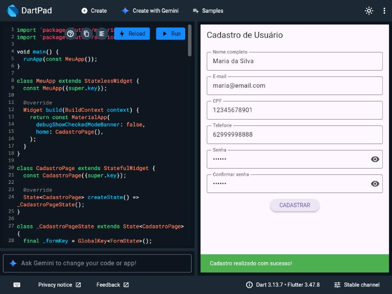
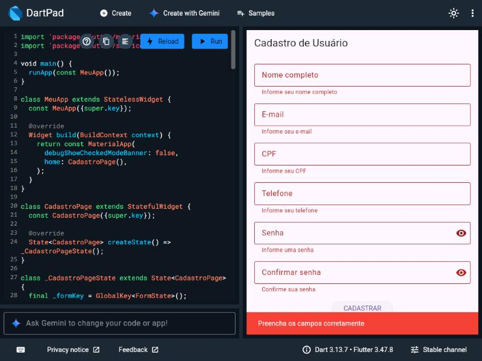

# Atividade 07 — Formulário de Cadastro de Usuário em Flutter

Tela de cadastro com `Form` + `TextFormField`, filtros de entrada, validação campo a campo e feedback com `SnackBar`.

## Campos e regras

| Campo | Teclado | Filtro | Validação |
|---|---|---|---|
| Nome completo | `name` | — | obrigatório |
| E-mail | `emailAddress` | — | obrigatório, contém `@` |
| CPF | `number` | `digitsOnly`, máx. 11 | obrigatório, somente números |
| Telefone | `phone` | `digitsOnly`, máx. 11 | obrigatório, 10–11 dígitos |
| Senha | — | — | obrigatória, mínimo 6 caracteres |
| Confirmar senha | — | — | igual à senha |

## Estrutura da tela

```
Scaffold
└── Form(key: _formKey)
    └── SingleChildScrollView
        └── Column
            ├── TextFormField (nome)
            ├── TextFormField (e-mail)
            ├── TextFormField (CPF)
            ├── TextFormField (telefone)
            ├── TextFormField (senha)
            ├── TextFormField (confirmar senha)
            └── ElevatedButton (CADASTRAR)
```

## Desafios extras implementados

- Confirmação de senha
- Botão mostrar/ocultar senha
- SnackBar de erro em vermelho

## Como rodar

```bash
flutter create .   # gera as pastas de plataforma (android, web, etc.)
flutter run
```

Ou cole o conteúdo de `lib/main.dart` em https://dartpad.dev e clique em **Run**.

## Resultado

Cadastro com todos os campos válidos (SnackBar de sucesso):



Tentativa de cadastro com os campos vazios (erros campo a campo e SnackBar de erro):


